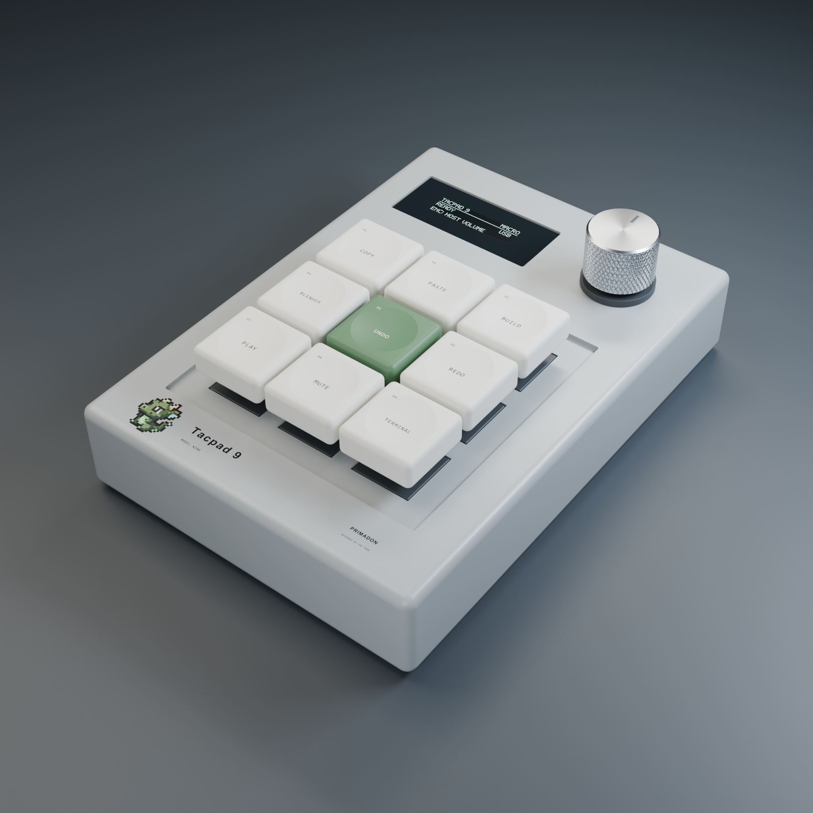
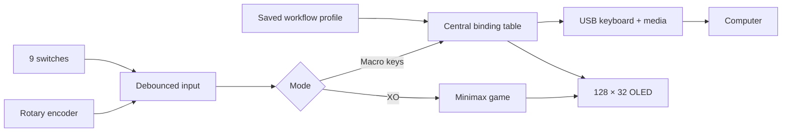

<div align="center">


# Tacpad 9

**MODEL NINE · A compact desk instrument by Primadon**

Nine tactile keys. One rotary control. A little room to play.


[Release downloads](https://github.com/syntaxguild/tacpad-9/releases/tag/v0.3.0) · [Case study](docs/case-study.md) · [Build guide](docs/assembly.md) · [ภาษาไทย](docs/README.th.md)

</div>


Tacpad 9 brings everyday keyboard shortcuts and media controls into an 85 × 120 mm enclosure. A horizontal OLED keeps feedback quiet; a knurled rotary knob handles volume; a moss-green centre key and the original Primadon mascot give the otherwise restrained industrial form its identity.

This repository connects **parametric Blender geometry, serviceable internal mounts, native USB firmware and an SSD1306 simulation** in one reproducible project. Coding, Blender and Media profiles share the same controls and remember the last successful selection. The same nine inputs also become a Tic-Tac-Toe board with a Minimax opponent.

**Behind the design:** read the [case study](docs/case-study.md) for the brief, packaging/budget decisions, firmware architecture and the evidence behind the prototype.

> **Prototype status:** software builds and digital geometry checks pass. The images are actual Blender renders. Physical print fit, delivered-component dimensions and USB operation on a real board remain to be tested. See the [validation record](docs/validation.md).

## A small object, considered inside and out

| Industrial design | Embedded behavior | Buildability |
|---|---|---|
| Softened rectangular shell, recessed key deck and dished caps | ESP32-S3 keyboard + consumer-control reports over native USB | Separate printable parts with nominal MX and D-shaft interfaces |
| Brushed-metal knob finish study, glossy display and team pad print | Nonblocking key-report scheduler, debounce and encoder capture | Four-screw underside access, removable OLED carrier and controller retainer |
| 19 mm key pitch and a wide 128 × 32 display | Three saved workflow profiles and a hold-to-toggle XO game | Sourced **฿497.20 purchasing plan**, including delivery reserve |

The aluminium appearance is a render finish; the budget build prints the knob and caps with the case. Printing uses an existing machine and filament. The parts/delivery plan is below ฿500, subject to the actual checkout total.

## The assembly


The shell carries the switch deck and screw bosses. Underneath, a removable carrier locates the OLED, an edge cradle holds the compact S3 board, and a separate retainer secures it without drilling the PCB. A rear opening admits the USB cable overmould. Hollow caps provide an MX cruciform socket; the knob has a D bore and push-switch clearance.

The exploded image uses the same geometry as the manufacturing exports. Electronic bodies are labeled reference envelopes, not supplier STEP models. Their fit assumptions and the remaining measurement gates are documented in the [hardware guide](docs/hardware.md).

<table>
<tr>
<td width="50%"></td>
<td width="50%"></td>
</tr>
<tr><td align="center">Primadon identity · 2048 × 2048</td><td align="center">Service access · actual modeled mounts</td></tr>
</table>

[Download square image](docs/assets/tacpad9-square.png) · [Download 16:9 image](docs/assets/tacpad9-wide.png)

## At a glance

| Parameter | Reference design |
|---|---|
| Enclosure | **85 × 120 × 22 mm**; controls extend above the shell |
| Key layout | 3 × 3, **19 mm pitch**, 17.6 mm caps, 4 mm nominal switch travel |
| Display | 0.91-inch SSD1306, **128 × 32**, 38 × 16 mm top window |
| Rotary control | 16 mm diameter × 12 mm knob, EC11 / KY-040 push encoder |
| Controller | ESP32-S3-Zero-style FH4R2, 4 MB flash, native USB-C |
| Manufacturing | FDM shell/base/carriers/caps/knob; M2 self-tapping screws |
| Output files | Packed `.blend`, individual mm-scale `.stl`, assembly `.obj`, firmware `.bin` |

## Three profiles, one surface

Tap and release the encoder to cycle **Coding → Blender → Media**. Its name appears on the OLED, and the selection is saved to NVS. Hold for 1.5 seconds to enter or leave XO; a long press never also changes profile. The physical legends below show the default Coding layout.

```text
COPY       PASTE      BUILD
BLENDER    UNDO       REDO
PLAY       MUTE       TERMINAL

Rotate → host volume     Tap → next profile     Hold 1.5 s → Macro / XO
```

Blender's profile provides Move/Rotate/Scale/Extrude, Undo/Redo, Edit, Deselect and Render. Media provides playback and volume controls. The [27-key reference](docs/keymap.md) is generated from the same C++ binding table that drives OLED labels, Serial descriptions and USB reports; CI checks it stays current.

Keyboard actions use Ctrl-based Windows/Linux shortcuts. Coding's BLENDER key emits Ctrl+Alt+Shift+B and needs a host launcher binding. A `*` after the profile name means its selection could not be saved. Volume uses relative consumer reports; the OLED does not invent a host volume percentage. In XO, the keys select cells and HID output is suppressed. The AI is checked against a full-tree oracle: **521 player paths, zero player wins**.

[Full key map and flashing](docs/firmware.md) · [GPIO wiring](docs/hardware.md#wiring-native-usb-hardware)



## Build it

**Firmware** — install PlatformIO, then:

```sh
pio run -e tacpad_s3
pio run -e tacpad_s3 -t upload
```

Hold BOOT while connecting USB for the first upload. Wire peripherals at 3.3 V using the [S3 pin map](docs/hardware.md). The original Wokwi diagram uses its own profile: `pio run -e esp32dev`. It validates UI/game simulation; it does not simulate native S3 USB HID.

**Model & photographs** — use Blender 4.x, with no add-ons or Python packages:

```sh
blender -b --python-exit-code 1 --python mechanical/validate.py
blender -b --python-exit-code 1 --python mechanical/render.py
blender -b --python-exit-code 1 --python mechanical/service.py
```

Open `mechanical/model.py` from disk in Blender's Scripting tab with `reference.json` alongside it. Edit `P` and rerun. Generated outputs go to `mechanical/exports/`; the studio includes packed branding, fonts, lights and both requested cameras. Print the fit coupon and one cap before the whole set. See [printing and assembly](docs/assembly.md).

**Checks** — reproduce the recorded behavior and provenance:

```sh
python scripts/check_repo.py
python scripts/check_firmware.py
pio run -e tacpad_s3 -e esp32dev
```

The host suite requires g++ and Node.js. GitHub Actions also builds both targets and runs Blender 4.0.2 geometry checks. [Validation scope and remaining physical tests →](docs/validation.md)

## Project map

```text
src/                    Main firmware and OLED/game flow
include/                Central keymap, pin map, USB actions, game engine, version
mechanical/             Parametric model, studio, reference data, geometry checks
chips/                  SSD1306-compatible Wokwi OLED source + compiled WASM
tests/                  Game, UI, HID and compiled-chip behavior checks
scripts/                Portable verification and release packaging
docs/                   BOM, wiring, assembly, validation and product images
.github/workflows/      Firmware and CAD validation
```

Large generated CAD and firmware bundles live in [versioned Releases](https://github.com/syntaxguild/tacpad-9/releases), keeping source browsing focused. Earlier design rounds remain in Git history with their original commits.

[Changelog](CHANGELOG.md) · [Contributing](CONTRIBUTING.md) · [Release v0.3.0](https://github.com/syntaxguild/tacpad-9/releases/tag/v0.3.0)

---

**Primadon · Tacpad 9 / Model Nine**

Industrial design exploration, embedded firmware and reproducible CAD. Team mascot supplied by Primadon. Third-party tools and libraries retain their own licenses and notices.
