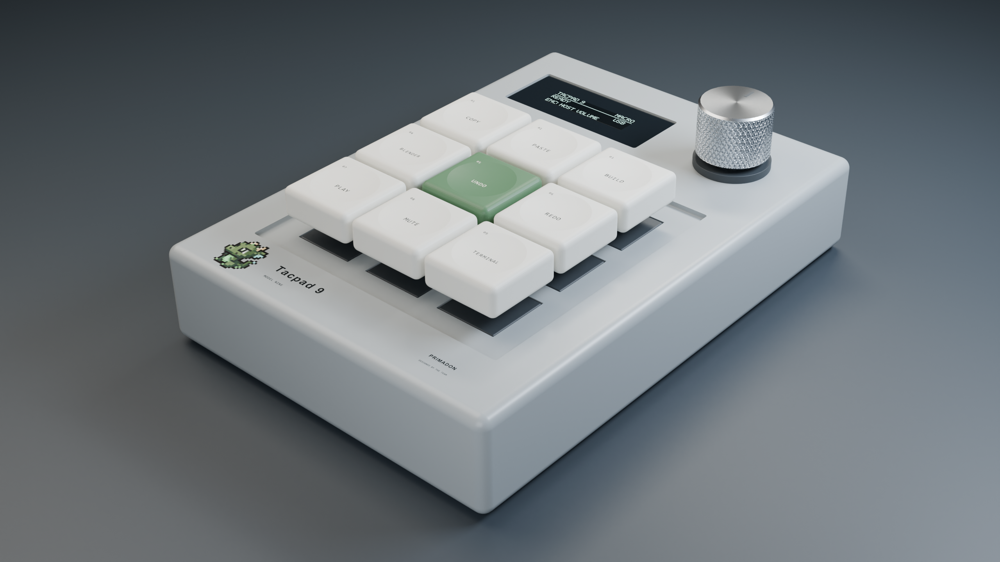
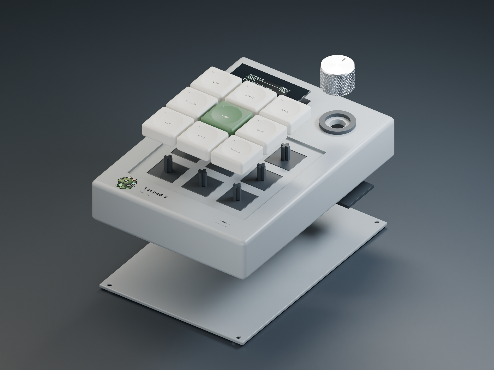

# Tacpad 9 / Model Nine — Primadon

แมโครแพด 9 ปุ่ม พร้อมปุ่มหมุน OLED และเกม XO ออกแบบเป็นเคสพิมพ์ 3D พร้อมโค้ด Blender และเฟิร์มแวร์ USB HID



รุ่น **0.3.0 เป็น digital prototype**: build เฟิร์มแวร์และตรวจโมเดลด้วย Blender แล้ว แต่ยังไม่ได้พิมพ์ประกอบหรือเสียบ USB ทดสอบบนบอร์ดจริง ภาพทั้งหมดเป็นภาพเรนเดอร์จากโมเดลจริงของโปรเจกต์

## เริ่มต้น

1. ดู [อะไหล่ งบ และขา GPIO](hardware.md) ใช้ ESP32-S3-Zero-style FH4R2 แบบไม่บัดกรี pin header
2. ติดตั้ง PlatformIO แล้วรัน `pio run -e tacpad_s3`
3. กด BOOT ค้างตอนเสียบสาย USB data ครั้งแรก แล้วรัน `pio run -e tacpad_s3 -t upload`
4. ต่อปุ่มแต่ละปุ่มระหว่าง GPIO กับ GND; จอและ encoder ใช้ 3.3 V
5. ทดสอบวงจรบนโต๊ะก่อนพิมพ์เคสเต็ม ตาม [ขั้นตอนประกอบ](assembly.md)

## งบรวมไม่เกิน 500 บาท

แผนอะไหล่ **402.20 บาท + สำรองค่าส่ง 95 บาท = 497.20 บาท** ใช้เครื่องพิมพ์ วัสดุพิมพ์ และเครื่องมือที่มี พิมพ์ keycap และ knob เอง โลหะในภาพเป็นแนวทางตกแต่ง รุ่นในร้านและค่าส่งจริงต้องตรวจที่ checkout ก่อนซื้อ ถ้าเกิน 500 บาทให้รวมร้านหรือใช้สาย USB ที่มี ห้ามตีความเงินสำรองว่าเป็นค่าส่งที่ยืนยันแล้ว

ลิงก์ร้านจริง ราคาอ้างอิง และรายการที่เป็นงบเผื่ออยู่ใน [BOM](hardware.md)

## ปุ่มและการใช้งาน

กด encoder สั้นแล้วปล่อยเพื่อวน **Coding → Blender → Media** จอแสดงชื่อโปรไฟล์และบันทึกค่าทันทีเมื่อสำเร็จ เพื่อโหลดกลับหลังเปิดเครื่องใหม่ กดค้าง 1.5 วินาทีเพื่อเข้า/ออกเกม XO โดยไม่เปลี่ยนโปรไฟล์ การกดสั้นในเกมไม่มีผล หมุน encoder เพื่อปรับเสียงในทุกโปรไฟล์ของ Macro mode

Coding ใช้ชุดปุ่มเดิม: Copy, Paste, Build, Blender, Undo, Redo, Play/Pause, Mute, Terminal ปุ่ม Blender ในชุดนี้ส่ง Ctrl+Alt+Shift+B ต้องตั้ง shortcut เปิดแอปในคอมเอง ส่วนโปรไฟล์ Blender ใช้ปุ่มจัดการโมเดลและ Render และ Media ใช้ปุ่มควบคุมการเล่น ดู [ตารางครบ 27 ปุ่ม](keymap.md) ที่สร้างจาก keymap กลางของโค้ด

ชื่อโปรไฟล์ที่มี `*` หมายถึงบันทึกลงหน่วยความจำไม่สำเร็จ แต่ยังใช้ค่าที่เลือกใน RAM ได้ เมื่อเปิดใหม่จะโหลดค่าที่บันทึกสำเร็จล่าสุด การล้างแฟลชหรือแฟลช merged image ทั้งก้อนอาจล้างค่าที่จำไว้ได้ การคงค่าหลังถอดสายยังต้องยืนยันกับบอร์ดจริง

## เหตุผลเบื้องหลังการออกแบบ

อ่าน [Case study](case-study.md) สำหรับโจทย์ ข้อจำกัดงบ การเลือก ESP32-S3 และการเดินสายแยก 9 ปุ่ม จุดยึดภายใน วิธีใช้ปุ่ม encoder สองจังหวะ และการใช้ keymap เดียวเชื่อม OLED/Serial/USB พร้อมหลักฐานทดสอบและสิ่งที่ยังต้องตรวจบนชิ้นงานจริง

## ตัวจำลอง

ตัวจำลอง Wokwi เดิมยังใช้ได้ผ่าน `pio run -e esp32dev` แต่เป็นการจำลอง UI/เกมและข้อความ Serial ไม่ใช่การทดสอบ native USB ของ S3 ดู [เฟิร์มแวร์และการควบคุม](firmware.md)

## โมเดล ภาพ และไฟล์ดาวน์โหลด

เปิด `mechanical/model.py` จากไฟล์ใน Scripting tab ของ Blender 4.x โดยมี `reference.json` อยู่ข้างกัน หรือรัน:

```sh
blender -b --python-exit-code 1 --python mechanical/validate.py
blender -b --python-exit-code 1 --python mechanical/render.py
blender -b --python-exit-code 1 --python mechanical/service.py
```

ไฟล์ที่สร้างอยู่ใน `mechanical/exports/` ส่วนไฟล์พร้อมดาวน์โหลดอยู่ใน [Release v0.3.0](https://github.com/syntaxguild/tacpad-9/releases/tag/v0.3.0): Blender, STL แยกชิ้น, OBJ, เฟิร์มแวร์ และ checksum



ก่อนพิมพ์ทั้งชุด ให้วัดโมดูลจริง โดยเฉพาะความสูงแกน encoder และขนาด OLED แล้วพิมพ์ coupon กับปุ่มเดียวเพื่อลอง fit ระยะเผื่อในไฟล์เป็นค่าตั้งต้น ไม่ใช่ผลทดสอบจากชิ้นงานพิมพ์แล้ว

[สถานะการตรวจสอบ](validation.md) · [README หลัก](../README.md) · [ประวัติรุ่น](../CHANGELOG.md)
