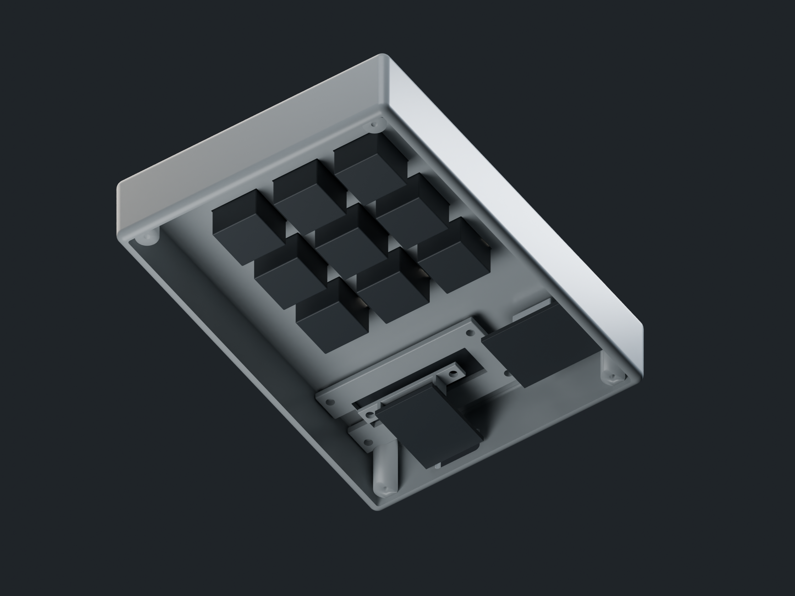

# Printing & assembly

This is a digitally checked prototype. No enclosure has been printed or fitted to delivered electronics yet. Start with the coupon and one cap before committing to a full set.



## Interfaces

| Interface | Nominal design |
|---|---|
| Enclosure envelope | 85 × 120 × 22 mm; controls project above it |
| Recess / deck | 1.2 mm recess; 1.5 mm deck below it |
| Keys | 19 mm pitch, 17.6 mm caps, 14.2 mm plate apertures |
| Keycap underside | Hollow shell, 1.3 mm sidewalls, reinforced MX cruciform socket |
| Stem socket | 4.1 mm span / 1.3 mm bar, provisional fit for 4.0 / 1.2 mm stem |
| Key travel | 4 mm, 0.8 mm skirt clearance at full press |
| Encoder | 7.4 mm panel aperture, threaded EC11 bushing and original nut |
| Knob | 16 mm diameter × 12 mm, diamond grip, 6.1 mm D bore |
| OLED | Removable carrier with 37.8 × 12.8 mm PCB pocket and rear component relief |
| Controller | Edge cradle and removable clamp; no holes drilled in PCB |
| Cable | Rear 14 × 8 mm rounded opening for USB plug overmould |
| Case closure | Four countersunk M2 × 8 self-tapping screws from underneath |

The print/export units are **millimetres**. Separate STLs are centered on XY and sit at Z=0; they are individual closed parts, not an assembly to print as one object. Print `keycap.stl` nine times. `fit-coupon.stl` is optional and outside the product assembly. The OBJ preserves assembly coordinates and separate objects. Glass, switch/board references, feet, ink and lights are excluded from manufacturing exports.

## Print orientation

Use a 0.4 mm nozzle, 0.16–0.20 mm layers and 3–4 perimeters in PLA+ or PETG. These are starting settings, not tested process qualifications. Print the base exterior face down. Print keycaps with the socket opening toward the bed and inspect the shallow internal roof; supports or a rotated orientation may be preferable on your printer. Print the shell with its open underside up and exterior top toward the bed, using supports for the recessed deck where needed. Protect the visible top face with a suitable smooth build surface. Orient the knob with its bore facing down; avoid filling the socket with difficult-to-remove supports.

Use the slicer preview to verify thin walls, bridges, seam placement and socket roofs. Print the switch aperture/pilot coupon first, then one cap and the knob. Tune `switch_hole`, `stem_span`, `stem_bar`, `shaft_diameter` and pilot diameter to measured parts and the printer. Do not force a tight printed socket onto a switch stem.

## Assembly sequence

1. Measure the actual board, OLED, encoder shaft/nut and switch. Compare with [reference.json](../mechanical/reference.json); rebuild if they differ. In particular, generic KY-040 modules vary in PCB size and shaft height.
2. Bench-flash the S3 before assembly. Test continuity, key actions and the USB data cable with the electronics loose.
3. Insert the nine switches from above into the plate openings. Check the retaining clips engage the 1.5 mm deck. This is a soldered hand-wire build, not a hot-swap PCB.
4. Fit the encoder from below through the panel and secure its supplied washer/nut above. Route or remove its tall header. Align the printed D-bore knob with the shaft; confirm at least 0.5 mm push-switch motion without touching the nut/bezel.
5. Place the OLED in its removable carrier, with its active pixels centered in the top window. Secure the carrier to the four blind roof bosses using M2 × 6 screws. Use thin adhesive or a nonconductive shim to retain the PCB within the pocket if needed; do not press on the glass. The black glossy cover in the image is a finish study; an inexpensive clear film can protect the actual module.
6. Place the S3 in the base cradle, with USB facing the rear opening. Fit the retainer with two M2 × 10 screws. Its edge tabs bear on PCB edges, not the MCU or USB shell. Confirm the cable reaches and seats completely.
7. Direct-solder the individual inputs and common ground per [hardware.md](hardware.md). Insulate joints, keep wires below the switch pins, and leave service slack at the OLED and encoder. Avoid the antenna region and screw bosses.
8. Fit the base and tighten four M2 × 8 screws gently. Check full key travel, encoder rotation/push, cable clearance and absence of pinched wires. Add printed caps only after switch travel is clear.

No adhesive permanently bonds the two case halves. Removing four underside screws gives access to wiring and the two removable carriers. The service image shows reference envelopes and mounts, not manufactured PCBs or routed wiring.

## Rebuild

```sh
blender --background --python-exit-code 1 --python mechanical/validate.py
blender --background --python-exit-code 1 --python mechanical/render.py
blender --background --python-exit-code 1 --python mechanical/service.py
```

Open `mechanical/model.py` from disk in Blender 4.x's Scripting tab and run it with `reference.json` beside it. Adjust `P` for exterior controls; the reference JSON and service layout define the selected hardware package. Header positions are the reference layout and the model is not a universal automatic packer for arbitrary boards. Running the model again replaces only its tagged objects.

The studio script writes a packed `.blend`, 2048² square photo, 2560 × 1440 wide photo and printable part exports under `mechanical/exports/`. Use `-- --preview` for quick lighting checks or `-- --setup-only` to save the scene without rendering. The original Primadon logo, fonts, lights, cameras and materials are packed into the studio scene. These are locally rendered CAD images.
