# Tacpad 9 / Model Nine

**A compact desk instrument, from industrial form to testable behavior.**

Primadon · Industrial design / embedded firmware / verification

Stage: v0.3.0 digital prototype · Hardware fabrication and real-host USB tests pending

## The brief

Build a nine-key desktop controller with an OLED strip and rotary input, give it a recognizable Primadon identity, and make the source and deliverables usable by another maker. The purchasing ceiling is **฿500 including delivery**, using an existing printer, material and tools for the enclosure and controls.

The resulting design joins an 85 × 120 × 22 mm shell, 19 mm key pitch, native USB keyboard/media firmware and a small game. Three profiles let the same physical surface serve Coding, Blender and Media work. An original team mascot, a moss-green centre key and a restrained grey/ivory finish connect the product to Primadon.

## Constraints shaped the architecture

| Constraint | Decision | Consequence |
|---|---|---|
| Direct keyboard and media control over USB | ESP32-S3 with native USB | The classic ESP32 diagram remains a separate simulation profile |
| ฿500 parts and delivery budget | Compact S3-Zero-style board; printed caps and knob; direct wiring | Clone dimensions and selected seller variants need checking before purchase |
| Nine inputs in a small volume | Nine independent GPIO inputs in a physical 3 × 3 layout | No scanning matrix, diodes or fabricated switch PCB; more individual wires |
| A 128 × 32 display | Profile name in the header, last action below | A readable state indicator instead of a nine-item on-device menu |
| Multiple workflows with one encoder switch | Short release changes profile; 1.5-second hold changes game mode | Gesture handling must prevent a hold from also registering as a tap |
| User-serviceable enclosure | Underside screws, separate OLED carrier and controller retainer | More printable parts, but accessible wiring and replaceable modules |

The [purchasing plan](hardware.md) totals **฿402.20 in listed prices/allowances plus ฿95 delivery reserve = ฿497.20**. This is a plan with a checkout gate, not a claim that a complete kit has been purchased or delivered for that amount.

## A surface with three working contexts

Coding preserves the original printed arrangement. Blender changes the same nine positions into modeling controls, including its Ctrl+Shift+Z redo shortcut. Media uses consumer usages for playback and volume. The [keymap reference](keymap.md) shows every assignment.

```mermaid
stateDiagram-v2
    [*] --> Macro: Load saved profile
    Macro --> Macro: Short encoder release / next profile + save
    Macro --> XO: Hold encoder 1.5 seconds
    XO --> Macro: Hold encoder 1.5 seconds
    XO --> XO: Keys select cells; short encoder taps ignored
```

The rotary direction controls host volume in every Macro profile. The USB device does not receive the host's volume percentage, so the display describes relative volume control rather than showing a guessed level. In XO, the nine inputs select cells and no keyboard/media actions are dispatched.

Manual profile selection keeps the controls usable without a companion application. The physical caps retain Coding legends and numbered positions; other profiles use the OLED and reference sheet. That is a deliberate usability tradeoff to evaluate with a real build.

## One binding table, several outputs

The initial firmware kept labels, diagnostic shortcut strings and USB dispatch rules in separate places. That allowed a change to update the visible name without changing the actual report, or vice versa.

[keymap.h](../include/keymap.h) now defines each binding once: label, modifier mask, keyboard key or consumer usage. The OLED and Serial diagnostics read that binding; [hid_output.h](../include/hid_output.h) copies it into a bounded report queue. The host test also exports the compiled table to generate the documentation, and CI rejects an outdated keymap reference.

Profile changes release reports and clear the queue before accepting new input. A held physical key must be released before the newly selected profile can use it. Disconnection and the transition into XO also clear actions, preventing stale shortcuts from crossing those boundaries. These behaviors are exercised by tests against the actual firmware entry points with USB doubles.

Preferences stores the selected profile ID in NVS once per deliberate change. A failed write keeps the selected RAM profile available and marks its OLED name with `*`; it does not claim the choice was saved. The behavior is tested for successful reads/writes, invalid stored IDs, unavailable storage and failed commits. Actual flash latency and power-cycle retention still need a board test.

## Geometry that can be inspected

The shell maintains the original envelope while adding closure bosses and a rear cable opening. Hollow caps have nominal MX cruciform sockets and a 4 mm travel allowance, leaving **0.8 mm skirt clearance** at full press. The 16 × 12 mm knob has a D bore and clearance for the encoder push switch. Reference electronics expose the intended packaging, while separate carriers give access to the OLED and controller.

Blender checks closed edges, connected components, positive volume and selected mesh intersections. During the digital fit review, the OLED carrier needed clearance around a closure boss, and the controller retainer needed its height adjusted to avoid overlapping the mounting posts. Those corrections are represented in the model and its [geometry report](../mechanical/validation.json).

Electronic shapes are provisional reference envelopes, not supplier-certified models. In particular, generic OLED and KY-040 modules vary. A mesh check cannot establish supplier tolerance, switch clip retention, printed socket fit or solder/wire clearance. The [assembly guide](assembly.md) starts with measuring the delivered parts and printing a coupon plus one cap.

## Evidence before claims

| Question | Current evidence | Remaining proof |
|---|---|---|
| Do all profiles dispatch the intended actions? | 27 expected keyboard/consumer mappings checked against actual firmware with USB doubles | Real S3 enumeration and host/application behavior |
| Do profile gestures and storage behave correctly? | Tap/hold isolation, debounce, held-key gating, timer wrap and NVS failure paths | Physical encoder feel, flash timing and power cycles |
| Does the game preserve its behavior? | 2,097 AI positions against a full-tree oracle; 521 player paths with zero X wins | Physical input/display use |
| Is the display implementation exercised? | OLED UI bounds plus tests of the compiled SSD1306-compatible WASM callbacks | Readability and electrical behavior of the purchased OLED |
| Are the parts digitally consistent? | Blender 4.0.2 geometry gate and millimetre-scale exports | Slicer review, fit prints and full assembly |

The [validation record](validation.md) includes the exact commands. GitHub CI builds both firmware targets and runs the native behavior tests and CAD checks. The release bundles include the source/reference data, manufacturing exports, firmware images and checksums. The product photographs are CAD renders; the images document the industrial design and Coding legends, not a captured v0.3.0 OLED session or a fabricated device.

## The next physical milestone

The next useful evidence is a measured build: identify the actual module variants, verify the coupon and sockets, flash the S3, test every profile with its intended application, check disconnect/mode transitions, and record several power cycles after profile changes. Publish that record with the printer/material, host OS and any necessary dimensional corrections before calling the project hardware-proven.

[Project overview](../README.md) · [Firmware and profiles](firmware.md) · [BOM and wiring](hardware.md) · [Validation](validation.md)
