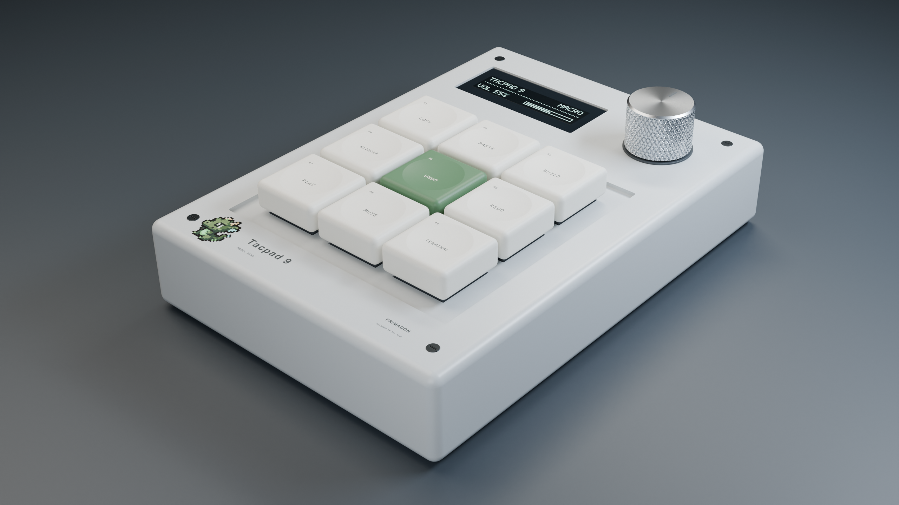

# Tacpad 9 / Model Nine

Product design by **Primadon**, built and photographed in Blender 4.0.2.
The original supplied team mascot is printed beside the product name, with
nearest-pixel sampling and its original transparency. A moss green centre key
ties the hardware colour to the mascot.



- [Square photograph, 2048 x 2048](../renders/primadon/Tacpad_9_Primadon_1x1.png)
- [Widescreen photograph, 2560 x 1440](../renders/primadon/Tacpad_9_Primadon_16x9.png)
- [Blender scene with packed logo, fonts, materials, lighting and cameras](../renders/primadon/Tacpad_9_Primadon.blend)
- [STL assembly](../renders/primadon/exports/Tacpad%209.stl)
- [OBJ assembly](../renders/primadon/exports/Tacpad%209.obj) and [materials](../renders/primadon/exports/Tacpad%209.mtl)

## Rebuild

The parametric source is [tacpad9_blender.py](../tacpad9_blender.py).
The photography script is [tacpad9_render.py](../tacpad9_render.py).
The original logo is [assets/primadon-logo.png](../assets/primadon-logo.png).
No third-party Python packages or Blender add-ons are required.

Open either script in Blender's Scripting tab and run it, or use:

```sh
blender --background --python tacpad9_render.py
```

Output is written to `renders/primadon/`. The saved scene opens with the square
camera active; press F12 to render again. The second camera is framed for 16:9.
Append `-- --preview` to the command for small lighting proofs of both images.

Change the `P` dictionary in the model script to adjust enclosure dimensions,
key pitch, dish depth, display placement and knob geometry. Camera framing,
logo placement and hardware decoration in the studio target the standard size.

## Dimensions and exports

| Part | Specification |
| --- | --- |
| Enclosure | 85 x 120 x 22 mm, rounded edges and hollow interior |
| Key layout | 3 x 3, 19 mm pitch |
| Keycaps | 17.6 mm square, 7 mm high, shallow concave dish |
| OLED opening | 38 x 16 mm, 4:1 active display, 128 x 32 luminous pixels |
| Knob | 16 mm diameter, 12 mm high, geometric diamond knurl |

Controls and silicone feet extend beyond the enclosure height. STL and OBJ
coordinates are millimetres; select mm when importing into a slicer. The STL
retains separate assembly bodies. Printed text, the mascot and luminous pixels
are presentation elements in the Blender scene. This remains a design concept;
production switch/stem fits and PCB mounts are not engineered.

The physical meshes were checked for closed manifold edges and positive volume.
The saved `.blend` packs the logo and fonts so the scene can be reopened without
the original workstation's asset paths.
